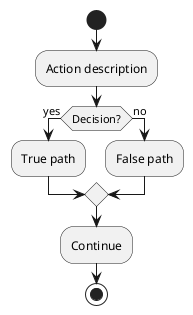
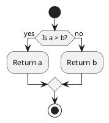

# PlantUML Activity Diagram Generator

Generates PlantUML activity diagrams from functions by analyzing control flow and translating it into abstract pseudocode.

## Setup

Verify dependencies are available:

```bash
java -version 2>&1 | head -1
test -f ~/plantuml.jar && echo "plantuml.jar found" || echo "MISSING: ~/plantuml.jar"
which feh && echo "feh found" || echo "feh not found (optional, for preview)"
```

## Workflow

### 1. Analyze the Function

Read the provided function and identify:
- **Start/end points**: Function entry and all return paths
- **Decisions**: `if`, `else if`, `else`, `switch/case`, ternary operators, loop conditions
- **Actions**: Assignments, function calls, calculations, I/O operations
- **Loops**: `for`, `while`, `do-while` — represent as decision+action combos or loop nodes
- **Early returns**: Guard clauses and error exits that bypass normal flow
- **Nested logic**: Nested conditionals and loops — flatten only when it improves readability

### 2. Write Abstract Pseudocode

Translate the operations into concise, abstract labels:
- Use plain English descriptions, not syntax: `:Validate input;` not `:if (ptr == NULL);`
- Merge trivial operations: combine a null check + return into one guard action
- Keep labels short but unambiguous
- Number or group related actions for clarity in complex functions

### 3. Build the PlantUML Diagram

Construct the diagram following PlantUML activity diagram conventions. See [references/plantuml-guide.md](references/plantuml-guide.md) for complete syntax reference.

Core structure:



Key rules:
- Every `@startuml` must have a closing `@enduml`
- Every `start` must reach a `stop` (or `end`)
- Use `if (condition) then (label)` / `else (label)` for branches
- Use `repeat` / `repeat while` for loops, or model loops as conditional branches
- Use `:Action text;` for actions (colons required)
- Use `->` arrows only when overriding automatic flow
- Use `note left/right` for annotations
- Use `partition "label" { ... }` for grouping related steps
- Use `#color:action;` for colored actions when highlighting

### 4. Write Output to File and Render

Save the diagram to a `.puml` file, then render with the render script:

```bash
/scripts/render.sh <diagram-file.puml>
```

The scripts directory is self contained in this skill's base directory

The script runs `java -jar ~/plantuml.jar -v -tpng` and opens the resulting PNG with `feh` for visual verification.

If render errors occur:
- Check the `-v` (verbose) output for syntax clues
- Verify all `if` blocks have matching `endif`
- Verify all `@startuml`/`@enduml` pairs
- Ensure no reserved keywords are used unquoted in labels

## Output Format

Always provide the complete PlantUML code wrapped between `@startuml` and `@enduml` tags. Precede it with a brief explanation of the control flow analysis.

## Example

**Input C function:**
```c
int max(int a, int b) {
    if (a > b) {
        return a;
    } else {
        return b;
    }
}
```

**Input Go function:**
```go
func Max(a, b int64) int64 {
	if a > b {
		return a
	} else {
		return b
	}
}
```

**Analysis:** Simple comparison with two return paths — one for `a > b`, one for the else case.

**Output:**

