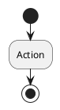
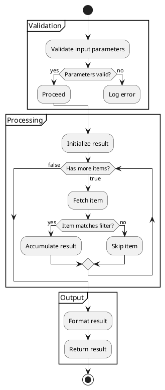

# PlantUML Activity Diagram Syntax Reference

## Basic Structure



Every diagram **must** start with `@startuml` and end with `@enduml`. Every `start` must have a corresponding `stop` or `end`.

Use `.puml` extension for files processed by Sphinx.

## Actions

```
:Simple action;
:Multi-line
action description;
:Action with **bold** and //italic//;
:Action with <style>custom styling</style>;
```

Actions are enclosed in colons. Use `;` to terminate. For inline markup, PlantUML supports creole syntax (`**bold**`, `//italic//`).

## Decisions (if/else)

```
if (Condition?) then (yes label)
  :True path action;
else (no label)
  :False path action;
endif
```

Multiple branches:

```
if (Condition A?) then (yes)
  :Path A;
elseif (Condition B?) then (yes)
  :Path B;
else (no)
  :Default path;
endif
```

**Important**: Every `if` must have a matching `endif`. Nested ifs need their own `endif`:

```
if (Outer?) then (yes)
  if (Inner?) then (yes)
    :Inner true;
  else (no)
    :Inner false;
  endif
else (no)
  :Outer false;
endif
```

## Loops

### While loop

```
while (Condition?) is (true)
  :Loop body;
endwhile (false)
:Continue;
```

### Repeat loop

```
repeat
  :Loop body;
repeat while (Continue condition?) is (true)
->false;
:Continue;
```

### Model loops as branches (alternative)

```
start
:Loop init;
if (More items?) then (yes)
  :Process item;
  ->Loop init;
else (no)
  :Continue;
endif
stop
```

## Parallel / Fork

```
fork
  :Task A;
fork again
  :Task B;
end fork
```

## Swimlanes / Partitions

```
partition "Initialization" {
  :Allocate memory;
  :Set defaults;
}
partition "Processing" {
  :Compute result;
}
partition "Cleanup" {
  :Free memory;
}
```

## Notes and Annotations

```
:Action;
note left: This is a left note
note right: This is a right note
:Action;
note left
  Multi-line
  note text
end note
:Action;
floating note left: Free-floating note
```

## Colors and Styling

```
:Highlighted action; <<#HotPink>>
:Success path; <<#palegreen>>
:Setup step; <<#lightblue>>
```

## Detach (end without stop)

```
if (Error?) then (yes)
  :Handle error;
  detach
else (no)
  :Continue;
endif
stop
```

Use `detach` for early termination flows (akin to `return` with no cleanup). Use `stop` for the main end point.

## Signals / Events

```
:Wait for data;
signal sent
:Notify listener;
signal received
:Continue;
```

## Complete Complex Example



## Common Pitfalls

| Issue | Fix |
|-------|-----|
| Missing `endif` | Every `if` must have `endif` (even nested) |
| Missing `endwhile` | Every `while` must have `endwhile` |
| `@startuml` without `@enduml` | Always close with `@enduml` |
| Reserved words in labels | Quote or rephrase (e.g., avoid bare `start`, `stop`, `if`, `else`) |
| Unclosed partition | Every `partition` needs `}` |
| Unclosed fork | Every `fork` needs `end fork` |
| Unclosed note | Multi-line notes need `end note` |
