

  

# PvAPI

Go backend for **PvAuto** ([pvauto.linhazero.com](https://pvauto.linhazero.com)), a
consignment marketplace. Shops send batches of products (*remessas*) to physical pickup
locations run by consignees; clients buy through a storefront and collect at the pickup
location with a QR code. The API handles catalogue, consignments, checkout, stock
reservation, per-shop earnings and shop withdrawals (*saques*) with admin moderation.

> **Historical repository.** This is the Go rewrite of PvAuto, written between March and
> June 2026. It is kept for reference and is no longer maintained.

Stack: Go, [Gin](https://github.com/gin-gonic/gin), [pgx/v5](https://github.com/jackc/pgx)
on PostgreSQL, [gin-jwt](https://github.com/appleboy/gin-jwt),
[shopspring/decimal](https://github.com/shopspring/decimal),
[go-mail](https://github.com/wneessen/go-mail).
API reference for integrators: [`Dev/llms.txt`](Dev/llms.txt) and the OpenAPI spec in
[`Dev/requests_implemented/api-integrations.yaml`](Dev/requests_implemented/api-integrations.yaml).
Domain glossary (Portuguese ↔ English terms): [`CONTEXT.md`](CONTEXT.md).

<table>
  <tr>
    <td>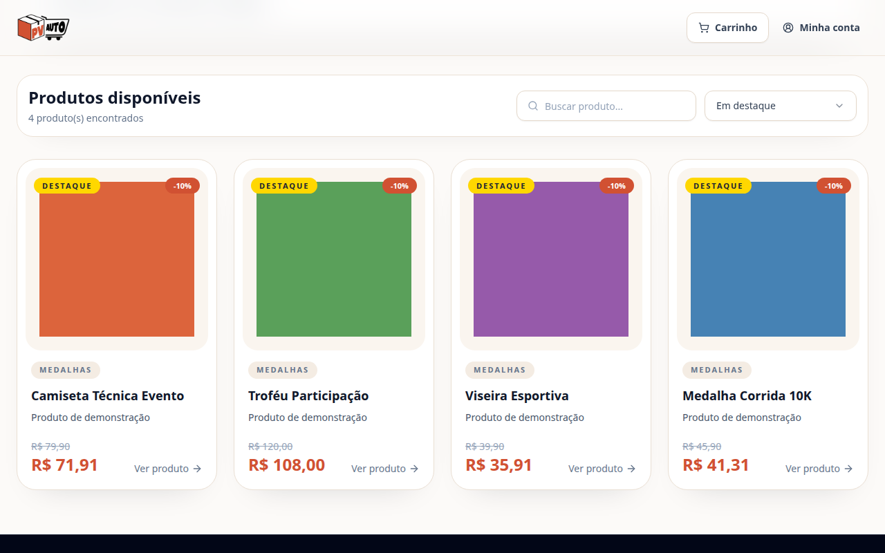 Storefront (frontend by Gabriel and Kerlon)</td>
    <td>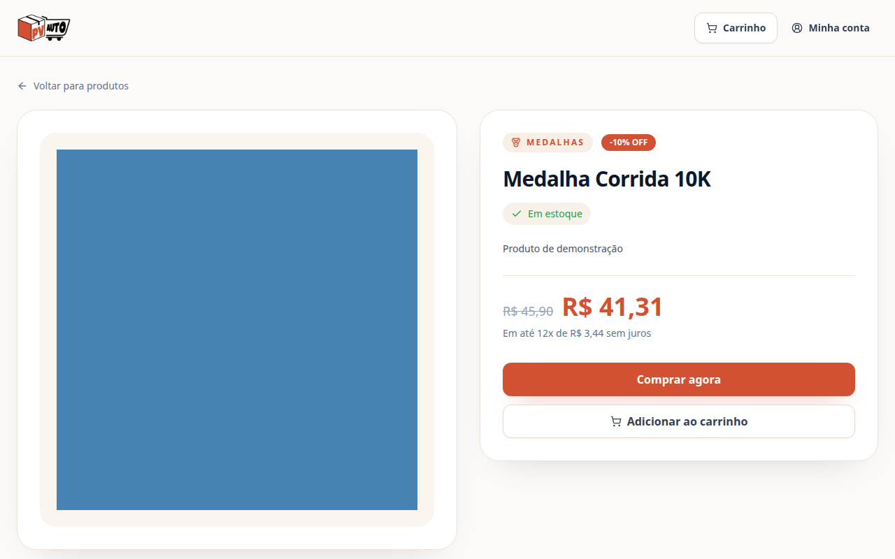 Product page with discounted price</td>
  </tr>
  <tr>
    <td>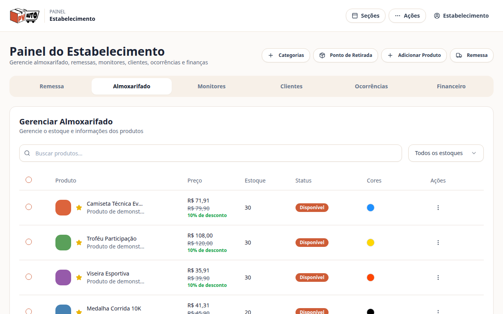 Shop dashboard: products and stock</td>
    <td>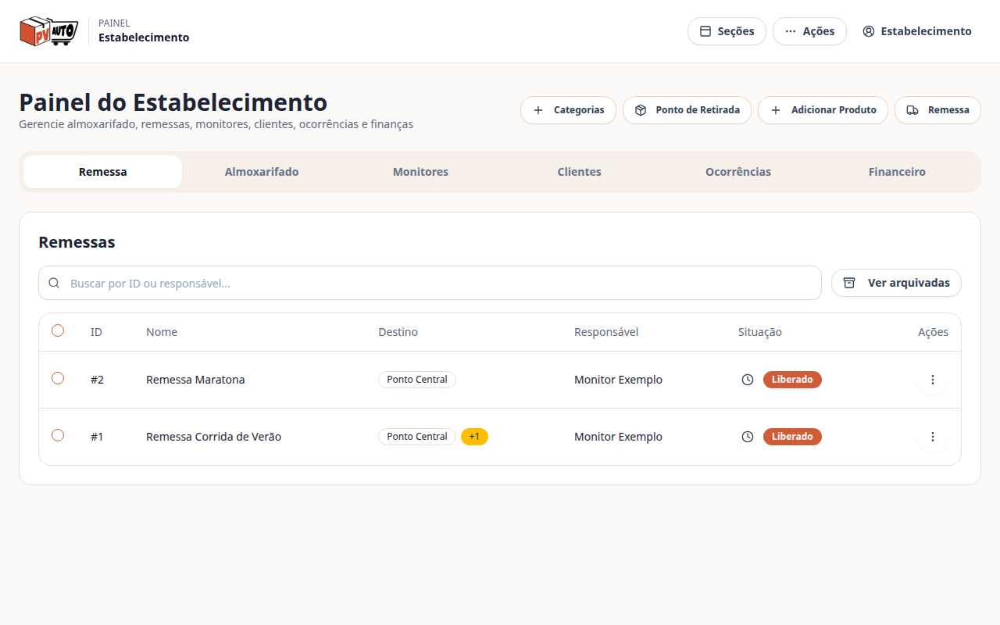 Consignments (remessas) and their pickup locations</td>
  </tr>
  <tr>
    <td>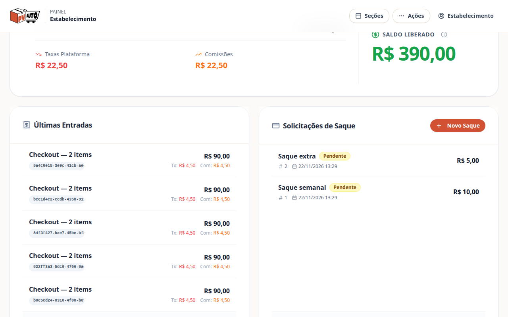 Finance: frozen per-checkout tax and commission, balance, saques</td>
    <td>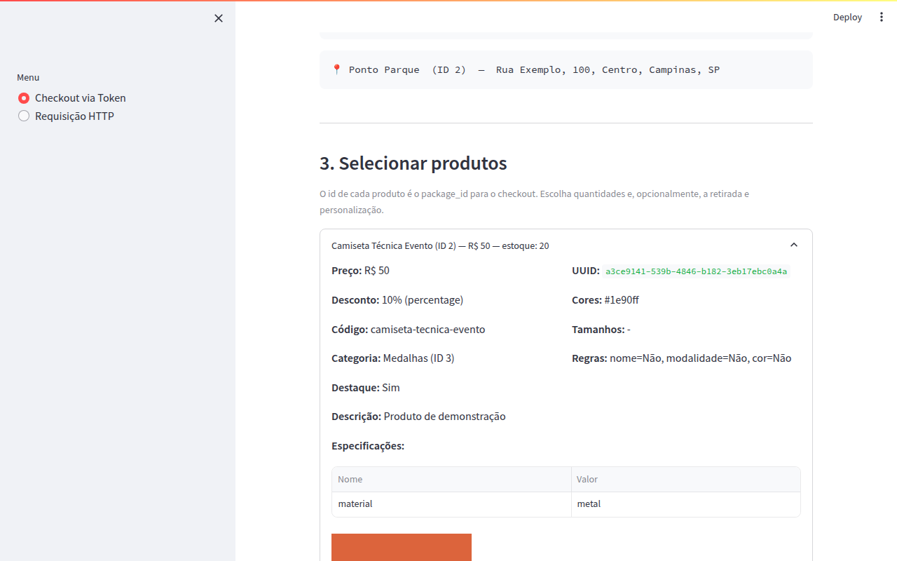 Partner example client: products and pickup points</td>
  </tr>
  <tr>
    <td colspan="2" align="center">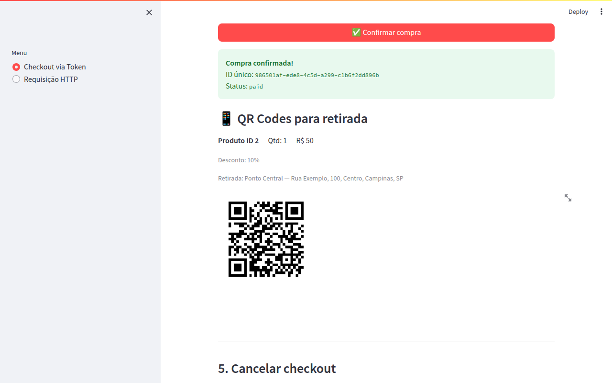 Checkout confirmed through the partner API, with one pickup QR code per reserved package</td>
  </tr>
</table>

All screenshots use the seeded test database; names, addresses and products are fictional.

## Contents

- [Architecture](#architecture)
- [Design decisions](#design-decisions)
  - [Checkout idempotency: three iterations](#checkout-idempotency-three-iterations)
- [How each part works](#how-each-part-works)
  - [User flow](#user-flow)
  - [Checkout transaction](#checkout-transaction)
  - [Money and saques](#money-and-saques)
  - [Authentication and authorization](#authentication-and-authorization)
  - [Partner API](#partner-api)
  - [Database](#database)
- [Testing](#testing)
- [AI-assisted engineering](#ai-assisted-engineering)
- [History](#history)

## Architecture

A conventional layered service. Each request goes through Gin middleware, a controller
that binds and validates the request, a model that owns the domain logic and the
transaction, and `query/`, which holds the SQL as plain strings run through a pgx pool.
No ORM.

  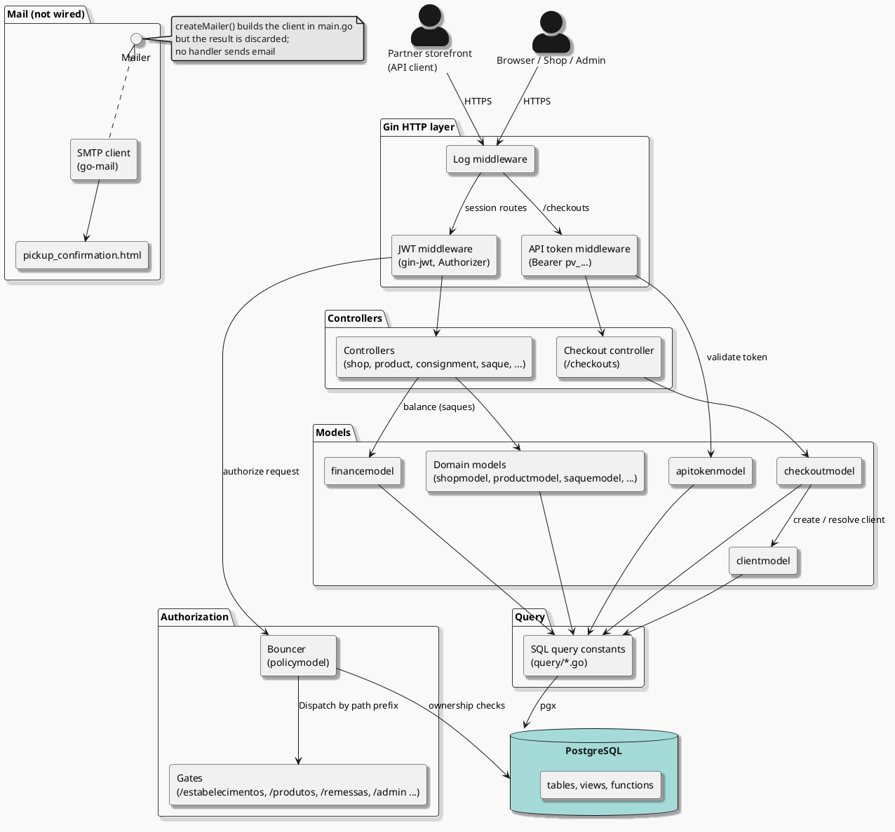

| Package | Role |
| --- | --- |
| [`routes.go`](routes.go), [`main.go`](main.go) | Router setup, route groups per role, dependency wiring |
| [`middleware/`](middleware) | Request logging, JWT (gin-jwt), partner API tokens |
| [`gate/`](gate) | One authorization gate per entity (implements `policymodel.Gate`) |
| [`controllers/`](controllers) | HTTP handlers: binding, error → status mapping |
| [`models/`](models) | Domain types, request/response DTOs and transactional logic |
| [`query/`](query) | SQL statements, one file per entity |
| [`internal/database/migrations/`](internal/database/migrations) | Sequential up/down migrations |
| [`util/`](util) | Checkout identity resolution, QR codes, helpers |
| [`mail/`](mail) | Pickup-confirmation mailer (built but not wired in; see [User flow](#user-flow)) |

Every entity follows the same 8-file shape: controller, `model.go`, `requests.go`,
`resources.go`, query file, gate, route group and gate registration. The checklist lives
in [`AGENTS.md`](AGENTS.md) so humans and agents add entities the same way.

## Design decisions

- **SQL in the open, transactions in the model.** Queries are strings in `query/`, so
  each lock and each `WHERE` is visible in review. The model owns the `pgx.Tx`, so one
  function holds one invariant from `BEGIN` to `COMMIT`.
- **Lock the row that owns the invariant.** Checkout locks the client row (rate limit) and
  each package row (stock); balance checks lock the shop row. Concurrent requests for the
  same client or shop are serialized; unrelated ones are not.
- **Freeze money at write time.** Each `checkout_shop` row stores the shop's value, tax and
  commission computed at checkout ([pvapi-20qk](.beans/pvapi-20qk--freeze-shop-level-values-at-checkout.md)).
  Later price or rate changes never rewrite past earnings.
- **`decimal.Decimal`, never `float64`, for money.** Rounding happens in SQL `numeric`.
- **Authorization as data.** Gates are registered by path prefix with one Bouncer, so an
  unprotected route is visible in `controllers/policy/policy.go` rather than hidden in a
  handler.
- **Specs before code.** Non-trivial changes start as a bean in [`.beans/`](.beans) with a
  problem statement, user stories and test plan; the idempotency history below is
  reconstructed from them.

### Checkout idempotency: three iterations

How to stop a double submit from creating two orders went through three designs.

| # | Mechanism | Introduced | Replaced because |
| --- | --- | --- | --- |
| 1 | Client-supplied `external_reference`, unique key | `3bd6221`, migrations 000019/000021 | It mixed an order tag with dedup: callers had to invent unique strings, and reusing one with a different payload silently returned stale data ([pvapi-0bi4](.beans/pvapi-0bi4--replace-external-reference-idempotency-with-conten.md)) |
| 2 | SHA-256 of canonical JSON (items sorted by package, value, email), `UNIQUE content_hash`, `ON CONFLICT DO NOTHING` then return the existing row | `adf34cd` (2026-06-05), migration 000042 | A hash has no notion of time: a client who bought the same item again a week later got the old confirmation and QR codes back, with no stock deducted and no new order ([pvapi-zle6](.beans/pvapi-zle6--replace-content-hash-dedup-with-client-based-rate.md)) |
| 3 | Per-client cooldown: lock the client row, reject a second checkout within 60 s with **429** and `retry_after` | `bfa4f14` (2026-06-10), migration 000047 | Current |

The third design drops payload-based idempotency entirely. A double submit within 60 s is
rejected with an exact wait time; a genuine repurchase always creates a new order. The
client is now created synchronously inside the checkout transaction (it used to be a
goroutine after the response), so the row exists to be locked. `external_reference` was
dropped in migration 000046 and `content_hash` in 000047; no code from either remains.

  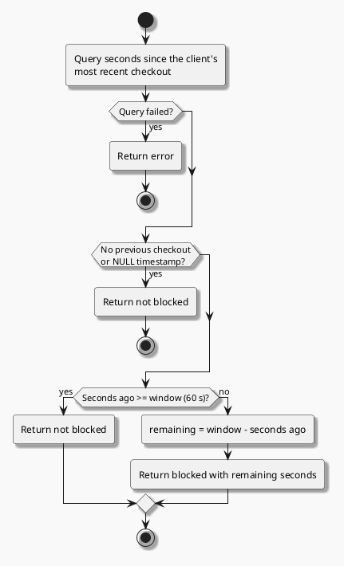

The trade-off is that a network retry after a successful but lost response gets a 429
instead of the original body. **Next step:** an `Idempotency-Key` header with the stored
response and a TTL, which separates retries from repurchases explicitly.

## How each part works

### User flow

The storefront is a separate frontend ([MyTempoESP/e-commerce](https://github.com/MyTempoESP/e-commerce)).
A consignment UUID in the link selects what is on sale; `GET /produtos?token=…` returns
the products and their pickup locations (*retiradas*). The cart is frontend state; the
cart tables were dropped in migration 000040. The storefront confirms the order with its
partner token and shows the QR codes the API returns, one per reserved package.

  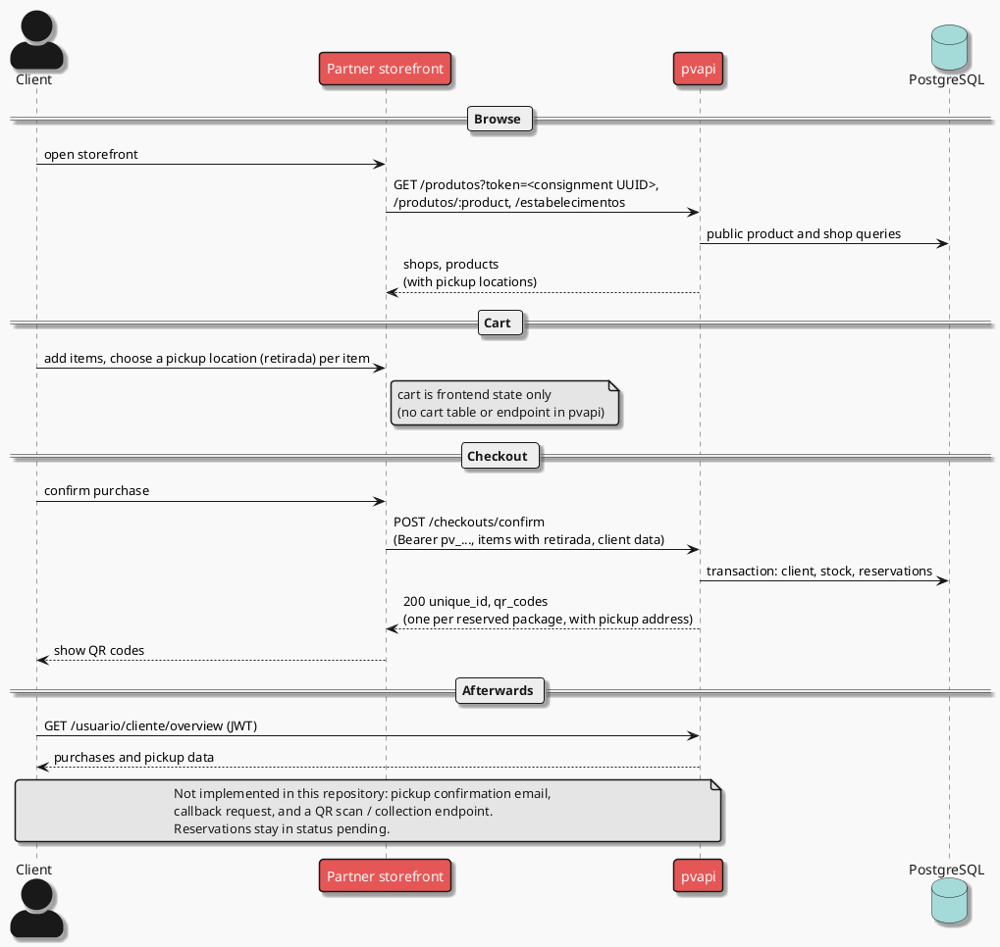

Not implemented in this repository: online payment (checkouts are recorded as `paid`), sending the
pickup email (the `mail/` package and template exist but `main.go` discards the mailer),
calling the stored callback URL, and an endpoint for the consignee to mark items collected.

### Checkout transaction

`checkoutmodel.Confirm` ([`models/checkoutmodel/checkout.go`](models/checkoutmodel/checkout.go))
runs one transaction:

1. Resolve the client identity: email, else CPF, else phone (`util/checkoutclient`).
2. `BEGIN`; create or fetch the client; `SELECT … FROM clients … FOR UPDATE`.
3. Rate limit (above): 429 with `retry_after`.
4. Insert the checkout.
5. `validateStock`: `SELECT quantity … FOR UPDATE` on every package (409/422).
6. Validate each item's pickup location against its consignment (422).
7. Per item: decrement stock in a CTE guarded by `quantity >= n` and insert a
   `package_reserved` row with frozen tax, commission and value.
8. Insert one `checkout_shop` row per shop, aggregated from the reservations.
9. Generate the QR codes; `COMMIT`. Any error rolls back everything, including a newly created client.

  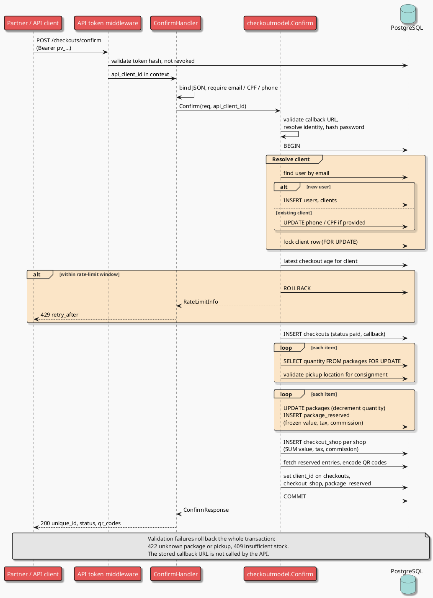

Activity diagrams: <code>Confirm</code> and <code>Cancel</code>

  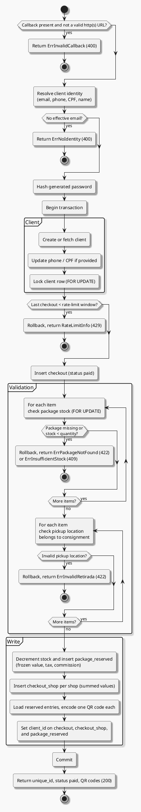
  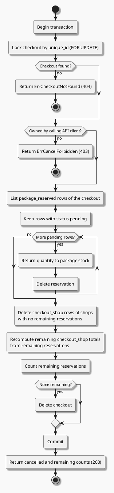

`Cancel` locks the checkout, checks that the calling partner owns it, restores stock for
reservations still `pending`, recomputes or deletes the affected `checkout_shop` rows, and
deletes the checkout when nothing remains.

Known gap: package rows are locked in request order, so two concurrent checkouts listing
the same packages in opposite order can deadlock. Postgres aborts one of them; sorting
the IDs before locking would prevent it.

### Money and saques

A shop's available balance is the sum of `shop_value − shop_tax − shop_commission` over its
`checkout_shop` rows, minus saques that are `pending` or `approved`.
`financemodel.AvailableBalance` locks the shop row first, so two concurrent withdrawal
requests cannot both spend the same balance.

  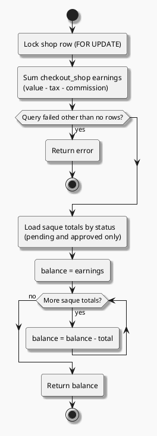

A saque starts `pending` after a balance check. An admin approves it (balance re-checked,
only while `pending`) or rejects it with a reason (*motivo*); the shop can cancel it.

  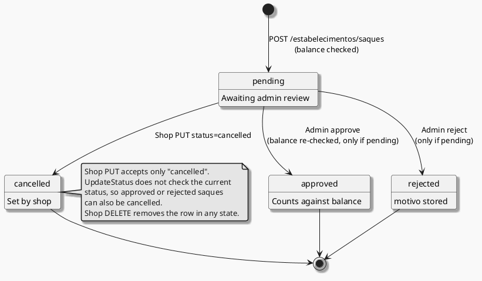

Known gap, shown in the diagram: the shop's cancel path updates status without checking
the current one, so an already approved or rejected saque can be set to `cancelled`.

### Authentication and authorization

- **Users** (shop, admin, client, consignee) log in through gin-jwt: HS256, 24 h tokens
  carrying `id`, `role` and `rid`.
- **Authorization** runs in the gin-jwt `Authorizer`
  ([`middleware/auth/auth.go`](middleware/auth/auth.go)): the Bouncer picks the first gate
  whose path prefix matches the route ([`models/policymodel`](models/policymodel)) and asks it
  about the role and resource. Gates live in [`gate/`](gate).
- **Partners** use API tokens on `/checkouts/*`, a route group that skips JWT and the
  Bouncer.

### Partner API

An admin issues tokens of the form `pv_` + 32 random bytes in hex. Only the SHA-256 hash is
stored, so a database leak does not leak usable tokens; the plain value is shown once.
[`middleware/apitoken`](middleware/apitoken) hashes the `Authorization: Bearer` value,
looks it up, and puts the API client ID in the context; `Cancel` uses it to refuse
cancelling another partner's checkout (403). A checkout may carry a callback URL, which is
validated (http/https) and stored but not yet called.

[`Dev/example-client`](Dev/example-client) is a Streamlit app for integrators: load a
consignment token, choose pickup locations and personalisation fields, confirm, display the
QR codes, cancel, plus a raw HTTP console.

### Database

PostgreSQL, 53 migrations (`000001_init` to `000057`, with gaps where early numbers were
dropped), each with an `up` and `down` file except `000015`. Read-side composition lives
in views (`product_catalog_view`, `consignments_active`, `shops_info_detailed_view`,
…) and pricing in plpgsql (`effective_unit_price`, discount-aware unit price). Some functions,
such as `package_decrement_quantity`, are no longer called since stock moved into the
checkout CTE.

  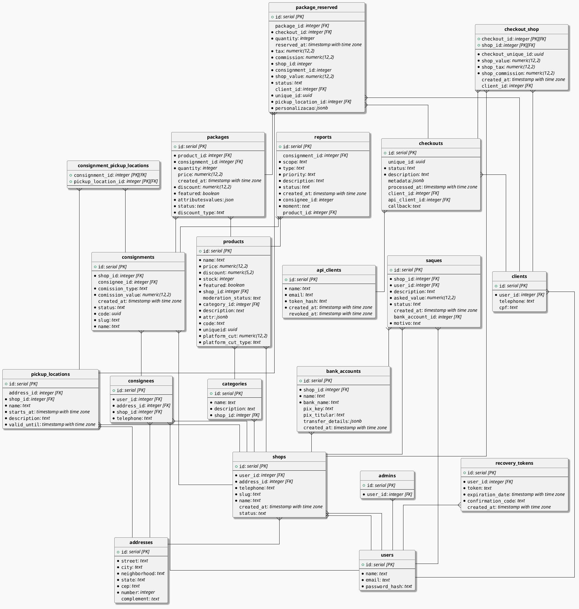
   Generated from the live schema with <code>just t::db-erd</code> (planter).

## Testing

19 black-box HTTP suites (`api_*_test.go`) run the real router, JWT middleware and Bouncer
against a real PostgreSQL through `httptest`. They share three helper files:

- [`api_harness_test.go`](api_harness_test.go): sets test env, seeds the admin, builds the
  router and a default partner token, and skips cleanly if the database is unreachable.
- [`api_fixtures_test.go`](api_fixtures_test.go): builders for shops, consignees, pickups,
  products, consignments, earnings, saques and checkouts, with unique suffixes so suites
  do not collide.
- [`api_assert_test.go`](api_assert_test.go): status and JSON assertions.

Concurrency-sensitive paths have their own suites: checkout rate limiting, cancel and
stock restore, `checkout_shop` aggregation, balance and saque moderation.

Everything runs through one script, [`.pi/skills/test-code/scripts/run.sh`](.pi/skills/test-code/scripts/run.sh).
It runs `golangci-lint --fix`, starts a throwaway Postgres container with its own data
directory per run, applies migrations, runs `go test` (optionally `-run` pattern,
`--race`, `--short`, timeout) and removes the database afterwards. Agents are not allowed
to call `go test` directly.

## AI-assisted engineering

From May 2026 most features were implemented by coding agents. I designed the workflow,
the guardrails and the specs; the agents implemented them under tests.

- **Specs as issues.** 64 beans in [`.beans/`](.beans), managed by the `beans` CLI, of which 42
  are completed. Most (49) have a problem statement, user stories, implementation decisions and
  a testing plan. Agents get "implement pvapi-XXXX" and nothing else.
- **Guardrails** in [`AGENTS.md`](AGENTS.md):
  - Tests run only through the test-code script, and agents may not truncate test output.
  - On a failure unrelated to the task, the agent stops and alerts me.
  - Every schema change needs an up/down migration pair.
  - New entities follow the 8-file checklist, and code follows the house Go style.
- **Skills** in [`.pi/skills/`](.pi/skills), run by the pi harness:
  - From [mattpocock/skills](https://github.com/mattpocock/skills), pinned in
    [`skills-lock.json`](skills-lock.json): `grill-me` and `grill-with-docs` (interrogate a
    design before writing it), `to-prd`, `to-issues`, `triage`, `diagnose`, `handoff`.
  - Written for this repo: `test-code`, `api-request`, `bank-saque`, `review`, `diagram`
    and `database-erd` (they produced the diagrams in this README).
- **Earlier phase.** 31 commits from 5 to 20 May 2026 are co-authored by aider
  (DeepSeek reasoner), before the beans/skills workflow existed.

## History

PvAuto first ran on a Laravel backend. This repository is its rewrite in Go, from
13 March to 19 June 2026: 489 commits on `wip`.

| Month (2026) | Commits | Migrations at month end | Test suites at month end |
| --- | ---: | ---: | ---: |
| March | 109 | 7 | 0 |
| April | 94 | 9 | 1 |
| May | 215 | 31 | 17 |
| June (to 19th) | 71 | 53 | 19 |

- **2026-03-13**: first commit and first migration (`f6a471c`); migrations moved to
  `internal/database/migrations` on 03-19 (`e8b3637`).
- **2026-03-25**: pickup locations and consignment routes (`befb26d`).
- **2026-04-09**: first API test suite (`0d9a74d`).
- **2026-05-05**: first aider/DeepSeek co-authored commit (`7899ccc`).
- **2026-05-21 → 05-26**: agent workflow adopted: `AGENTS.md` (`7cc54f3`), `.pi` skills
  (`532e3ac`), beans (`15d5b4f`).
- **2026-05-25 / 05-29**: saques (`6dd18a8`), then admin approval and rejection (`584af06`).
- **2026-06-01**: frozen per-shop values in `checkout_shop` (`67a5c36`).
- **2026-06-04 / 06-05**: checkout without server-side carts (`7164b6d`); several pickup
  locations per consignment (`0fd4960`); content-hash dedup (`adf34cd`).
- **2026-06-10**: partner API tokens (`b70157d`); `external_reference` removed (`283f120`);
  per-client rate limit (`bfa4f14`).
- **2026-06-18**: development scaffolding and stale docs removed (`4a0dffb`).

Beans: 27 opened in May and 37 in June; 42 completed or done.

The storefront frontend was built by Gabriel and Kerlon.
